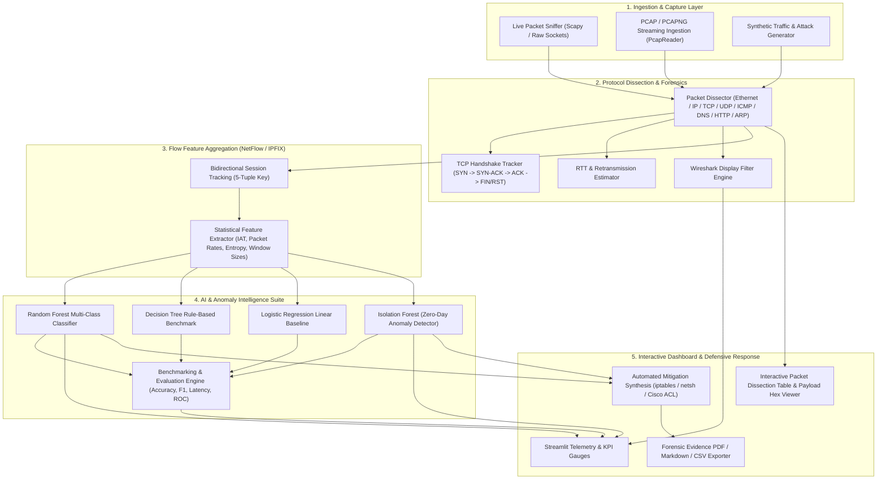

# AI-Driven Network Traffic Intelligence Dashboard

**Course Title:** Computer Networks Lab  
**Course Code:** BCSE308P | **Slot:** L15+L16 | **Class ID:** VL2026270103216  
**Institution:** School of Computer Science and Engineering (SCOPE), VIT, Vellore - 632014  
**Faculty Incharge:** Dr. S. Ebenezer Juliet, Professor Grade 1, Dept. of Analytics, SCOPE  
**Academic Year:** Fall Semester 2026-2027  

---

## 🌟 Executive Summary & Project Overview

The **AI-Driven Network Traffic Intelligence Dashboard** is an enterprise-grade, end-to-end network forensics and automated intrusion intelligence platform. Designed specifically for the **BCSE308P Innovative Practices Project Component**, the system integrates packet-level protocol dissection (emulating and extending Wireshark) with machine learning pipelines to detect, classify, and mitigate cyber threats in real time.

The project addresses **Problem Statement IV: Real-Time Network Packet Forensics and Protocol Analysis** and integrates multi-class supervised learning with unsupervised zero-day anomaly detection to achieve top-tier marks across all levels of the **Revised Bloom's Taxonomy** (Understand [3M], Apply [5M], Analysis [7M], Evaluate [10M], and Project Report [5M]).

---

## 🏗️ System Architecture



---

## 📊 Bloom's Taxonomy Mapping & Rubrics Alignment

| Bloom's Level | Marks | Project Implementation Details |
| :--- | :---: | :--- |
| **Understand** | **3** | Deep mathematical and conceptual grounding in OSI/TCP-IP layering, packet encapsulation, TCP flag states (SYN, ACK, FIN, RST, PSH, URG), sequence and acknowledgement numbers, window scaling, DNS query-response structures, and Shannon entropy. |
| **Apply** | **5** | Real-time packet sniffer and PCAP reader built with Scapy; bidirectional flow extraction adhering to CIC-IDS / NetFlow standards; calculation of inter-arrival times (IAT), byte rates, and payload entropy. |
| **Analysis** | **7** | Real-time TCP 3-way handshake state tracking, round-trip time (RTT) calculation, packet loss and retransmission estimation, TCP vs UDP comparative forensics, and Wireshark display filter queries (`tcp`, `udp`, `dns`, `ip.addr==x.x.x.x`, `syn`). |
| **Evaluate & Higher** | **10** | Multi-model comparative evaluation comparing **Random Forest**, **Decision Tree**, **Logistic Regression**, and **Isolation Forest** across Accuracy, Precision, Recall, F1-Score, and inference latency; automated generation of defensive mitigation rules (`iptables`, Windows `netsh`, Cisco ACLs). |
| **Project Report** | **5** | Comprehensive formal project report adhering 100% to the prescribed VIT template format. |

---

## 🚀 Quick Start Guide

### 1. Requirements
- Python 3.10+ (tested on Python 3.13)
- Dependencies installed via:
```bash
pip install -r requirements.txt
```
(The first start trains the models, which takes about a minute; they are then saved in `models/`.)

### 2. Run Comprehensive Unit Tests
```bash
python tests/test_pipeline.py
python -m unittest tests.test_improvements
```

### 3. Run Command-Line Terminal Demo
```bash
python demo_cli.py
```

### 4. Launch Interactive Web Dashboard
```bash
streamlit run dashboard/app.py
```
*Or double click `run_dashboard.bat` on Windows.*

The dashboard will open automatically in your browser at `http://localhost:8501`.

---

## 🛡️ How Alerts Are Decided

1. **Per-flow verdicts.** A Random Forest classifies each flow and an Isolation Forest flags unusual ones. Flows addressed to a multicast or broadcast group (mDNS, SSDP, DHCP, NetBIOS...) are marked `is_multicast_dst` and can never be reported as a flood or scan (the sidebar has a switch to turn this guardrail off for comparison).
2. **Incidents.** Flagged flows are grouped (a flood of spoofed sources becomes one incident). An incident is **confirmed** only at or above the confidence threshold (sidebar slider, default 70%) *and* with enough supporting flows; anything else is listed as **needs review** and produces no alert or firewall rule.
3. **Packet-level detectors** for **ARP spoofing** and **Slowloris** read packets directly and explain their score.
4. **Allowlist.** Trusted IPs, CIDR ranges and MACs (sidebar; saved to `allowlist.json`) are excluded from incidents. Trusting a host also trusts attacks aimed at it; an IP entry never hides ARP spoofing, only a trusted MAC does.
5. **Evidence report** as PDF, Markdown or CSV from the *Forensic Evidence* page.

**Large captures** are streamed one packet at a time. In the sidebar, *Capture limits* sets how many packets to analyse (default 200,000) and how many recent packets the packet table keeps (default 20,000). Parsing runs at roughly 3,000 packets/s (limited by Scapy).

### Measuring false alarms on your own captures

```bash
python tools/evaluate_captures.py captures/home_wifi.pcapng captures/video_call.pcapng     # benign: every alert is a false alarm
python tools/evaluate_captures.py --attack lab/mitm.pcap:ARP_SPOOFING                       # attack capture: lists detected / missed
python tools/evaluate_captures.py --simulate captures_sim/ captures_sim/                    # simulated demo set (NOT real traffic)
```

### Limitations (read before trusting the numbers)

- All accuracy figures come from **simulated** traffic produced by this project's generator, which also supplies the training data. 100% on simulated data shows the pipeline is consistent, not that it is accurate on a real network. Measure real captures with the tool above.
- The Isolation Forest is a weak signal on the current data; its verdicts are only ever "needs review".
- The multicast guardrail treats any `x.x.x.255` as broadcast without knowing the subnet mask and ignores floods addressed to a group by design.
- ARP spoofing and Slowloris detection are heuristics (DHCP reassignment also looks like an ARP conflict; Slowloris detection covers cleartext HTTP only).

See Section 12 of the project report for the full list.

---

## 📁 Project Directory Structure

```text
ai_network_traffic_dashboard/
├── core/
│   ├── __init__.py
│   ├── sniffer.py              # Streaming PCAP parsing, protocol dissection
│   ├── feature_extractor.py    # Bidirectional NetFlow/IPFIX statistical flow extraction
│   ├── traffic_generator.py    # Normal / multicast traffic and attack simulation generator
│   ├── ai_engine.py            # Multi-model AI classifier, Isolation Forest, multicast guardrail
│   ├── incidents.py            # Flow grouping into incidents + confidence threshold
│   ├── detectors.py            # ARP spoofing and Slowloris detectors
│   ├── allowlist.py            # Trusted IP / CIDR / MAC allowlist
│   ├── session.py              # One packet stream feeding flows, detectors and the packet table
│   ├── report.py               # PDF and Markdown evidence report
│   └── forensics.py            # Handshake tracking, RTT, Wireshark filter & mitigation rules
├── dashboard/
│   └── app.py                  # Interactive Streamlit intelligence dashboard
├── models/                     # Pre-trained joblib weights & benchmark artifacts
├── pcap_samples/               # Pre-populated evaluation PCAP traces
├── tools/
│   └── evaluate_captures.py    # False-positive / detection report for capture files
├── docs/
│   └── evaluation_simulated.md # Results on simulated captures (not real traffic)
├── tests/
│   ├── test_pipeline.py        # 6 end-to-end pipeline tests
│   └── test_improvements.py    # 31 tests: multicast, incidents, allowlist, streaming, detectors, reports
├── demo_cli.py                 # Full terminal demonstration runner
├── run_dashboard.bat           # Windows 1-click batch launcher
├── README.md                   # Technical documentation
└── BCSE308P_PROJECT_REPORT.md  # Formal VIT Lab Project Component Report
```
